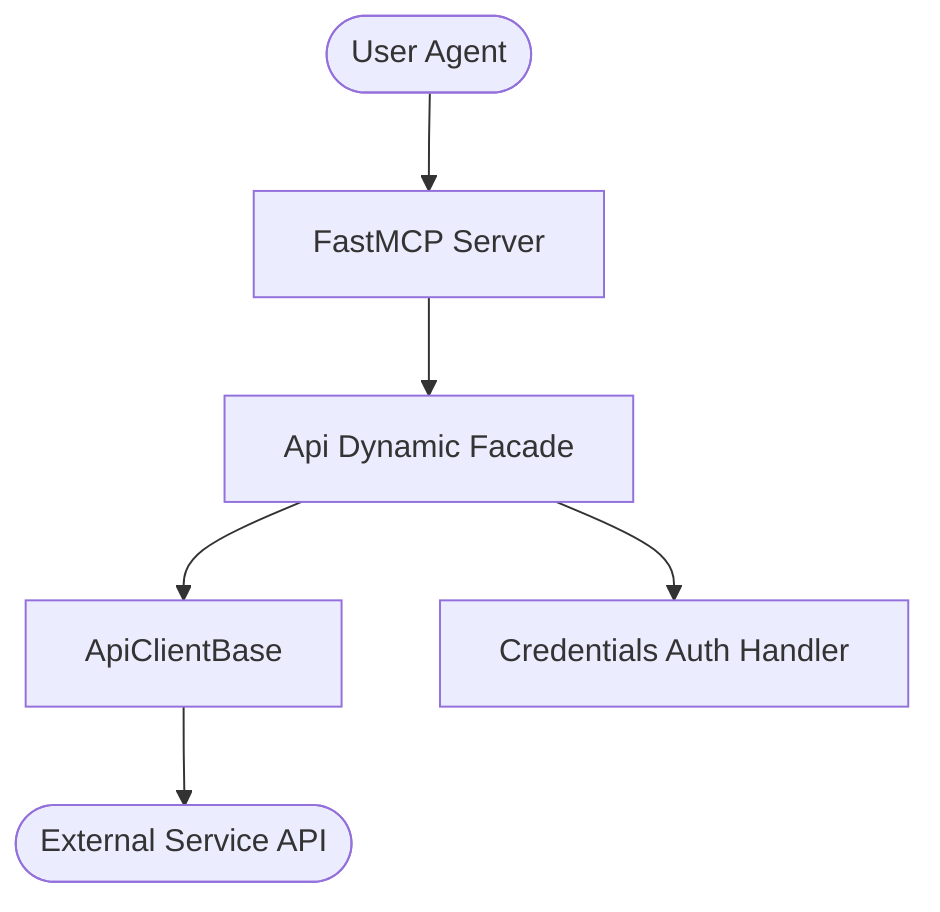

# Openbao MCP

[](https://github.com/genius-agents/openbao-mcp)
[](pyproject.toml)
[](LICENSE)

OpenBao Secrets and Encryption Key Vault orchestrator. Built with the highest architectural standards, incorporating dynamic facades, custom API routing, and FastMCP tool decoration.

> **Documentation** — Installation, deployment, usage across the API, CLI, and MCP
> interfaces, and guidance for provisioning the OpenBao backend are maintained in the
> [official documentation](https://knuckles-team.github.io/openbao-mcp/).

## Table of Contents
- [Overview](#overview)
- [Features](#features)
- [Installation](#installation)
- [Usage](#usage)
- [Configuration](#configuration)
- [MCP Tools](#mcp-tools)
- [Architecture](#architecture)
- [Deployment](#deployment)
- [Contributing](#contributing)
- [License](#license)

---

## Overview

Openbao MCP provides a high-performance, model-optimized interface to Openbao capabilities. It isolates the model from underlying API transport complexity, ensuring safe, idempotent, and highly traceable system interactions.

---

## Features

- **Dynamic Facade Orchestration**: Integrates multi-inheritance clients cleanly under a single facade.
- **Battle-Tested Resilience**: Out-of-the-box credential authentication, connection polling, and request retry strategies.
- **FastMCP Declarative Tools**: Fast, native schema registration with full inline validation.
- **Complete Test Intent Diversity**: Deep, automated unit, integration, and mock tests ensuring high code coverage.

---

## ⚙️ Dynamic Tool Selection & Visibility

This MCP server supports dynamic toolset selection and visibility filtering at runtime. This allows the operator to restrict the set of exposed tools to prevent blowing up the LLM's context window.

The operator can configure tool filtering via multiple input channels:

- **CLI Arguments:** Pass `--tools` or `--toolsets` (or their disabled counterparts `--disabled-tools` and `--disabled-toolsets`) during startup.
- **Environment Variables:** Define standard environment variables:
  - `MCP_ENABLED_TOOLS` / `MCP_DISABLED_TOOLS`
  - `MCP_ENABLED_TAGS` / `MCP_DISABLED_TAGS`
- **HTTP SSE Request Headers:** Pass custom headers during transport initialization:
  - `x-mcp-enabled-tools` / `x-mcp-disabled-tools`
  - `x-mcp-enabled-tags` / `x-mcp-disabled-tags`
- **HTTP SSE Request Query Parameters:** Append query parameters directly to the operator's transport connection URL:
  - `?tools=tool1,tool2`
  - `?tags=tag1`

When query strings or parameters are provided, an LLM-free **Knowledge Graph resolution layer** (using `DynamicToolOrchestrator`) matches query intents against known tool tags, names, or descriptions, with safe fallback and automated 24-hour background cache refreshing.


---

## Installation

> **Install the connector-focused `[mcp]` extra.** Examples use `openbao-mcp[mcp]` to add
> FastMCP / FastAPI through `agent-connector-sdk`; the required Agent Connector SDK core
> enables model orchestration.

Pick the extra that matches what the operator want to run:

| Extra | Installs | Use when |
|-------|----------|----------|
| `openbao-mcp[mcp]` | Connector-focused MCP server (`agent-connector-sdk` — FastMCP/FastAPI + `epistemic-graph[full]`) | The operator only run the **MCP server** (smallest install / image) |
| `openbao-mcp[all]` | Everything (`mcp` + `agent` + `logfire`) | Development / both surfaces |

```bash
# Connector-focused MCP server (includes the shared graph engine)
uv pip install "openbao-mcp[mcp]"

# Agent runtime (adds model orchestration to the shared graph engine)

# Everything (development)
uv pip install "openbao-mcp[all]"      # or: python -m pip install "openbao-mcp[all]"
```

### Container images (`:mcp`)

One multi-stage `docker/Dockerfile` builds the MCP-only image (`--target mcp`):

| Image tag | Build target | Contents | Entrypoint |
|-----------|--------------|----------|------------|
| `example/openbao-mcp:mcp` | `--target mcp` | `openbao-mcp[mcp]` — **connector-focused**, includes `epistemic-graph[full]`; no model-orchestration stack | `openbao-mcp` |

```bash
docker build --target mcp   -t example/openbao-mcp:mcp    docker/   # connector-focused MCP server
```

`docker/mcp.compose.yml` runs the connector-focused `:mcp` server; `docker/compose.yml` runs the
agent (`immutable agent digest`).

### Knowledge-graph database (`epistemic-graph`)

Agent Connector SDK core dependency (`epistemic-graph[full]`). The `[mcp]` extra keeps
deployments can use the bundled engine. For production or shared state, run
**epistemic-graph as a dedicated database service** and configure the runtime to use it.
Deployment recipes (single-node + Raft HA), connection configuration, and architecture
diagrams are documented in the
[epistemic-graph deployment guide](https://knuckles-team.github.io/epistemic-graph/deployment/).

---

## Usage

The operator can start the FastMCP server in stdio mode via Python module execution:

```python
import asyncio
from openbao_mcp.mcp_server import get_mcp_instance


async def main():
    mcp = get_mcp_instance()
    # Execute stdio loop or launch server
    print("MCP Server ready.")


if __name__ == "__main__":
    asyncio.run(main())
```

For direct shell start, ran:

```bash
python -m openbao_mcp.mcp_server
```

---

## Configuration

The package is fully configurable via the environment variables listed below:

| Variable | Description | Default | Required |
|----------|-------------|---------|----------|
| `OPENBAO_URL` | The primary URL of the OpenBao server. | `http://127.0.0.1:8200` | Yes |
| `OPENBAO_TOKEN` | Runtime-injected service account access token. | None | Yes |
| `BAO_ADDR` | Alias/fallback for the OpenBao server address. | None | No |
| `VAULT_ADDR` | Alias/fallback for the OpenBao/Vault server address. | None | No |
| `OPENBAO_MCP_BASE_URL` | Alternative fallback URL for user-level client endpoints. | `http://127.0.0.1:8200` | No |
| `OPENBAO_MCP_USERNAME` | Username for username/password authentication methods. | None | No |
| `OPENBAO_MCP_PASSWORD` | Password for username/password authentication methods. | None | No |
| `TLS_PROFILE` / `TLS_PROFILE_REF` | AgentConfig private-CA/mTLS transport selector; verification is mandatory. | None | No |
| `SECRETSTOOL` | Enable/disable Secrets Engine MCP tools namespace. | `True` | No |
| `SYSTOOL` | Enable/disable System Administration MCP tools namespace. | `True` | No |
| `AUTHTOOL` | Enable/disable Authentication Engine MCP tools namespace. | `True` | No |
| `SSHTOOL` | Enable/disable SSH Management MCP tools namespace. | `True` | No |

A local template is provided inside [.env.example](.env.example). Copy this file as `.env` and fill out the operator's specific service endpoint parameters before starting execution.

---

## MCP Tools

The following declarative FastMCP tools are registered and available to upstream AI agents. This table is auto-generated from the live server — do not edit by hand.

<!-- MCP-TOOLS-TABLE:START -->

#### Intent tools

| MCP Tool | Kind | Description |
|----------|------|-------------|
| `openbao_ingest_mounts` | intent | Natively ingest OpenBao secrets-engine METADATA into epistemic-graph. |
| `openbao_mcp_auth` | intent | Manage OpenBao auth operations. |
| `openbao_mcp_kv` | intent | Manage OpenBao Key-Value v1 and v2 engines. |
| `openbao_mcp_logical` | intent | Manage OpenBao logical operations. |
| `openbao_mcp_ssh` | intent | Manage OpenBao SSH and SSH Helper operations. |
| `openbao_mcp_sys` | intent | Manage OpenBao sys operations. |

_6 intent tool(s) · 0 operation(s). Call an operation as `act(action='<operation>', params={...})` (`ask` for reads); `find(action='describe', params={'action': '<operation>'})` returns its arguments. An operation is enabled unless its `<DOMAIN>TOOL` toggle is set false. Auto-generated — do not edit._
<!-- MCP-TOOLS-TABLE:END -->

See [docs/overview.md](docs/overview.md) or [docs/concepts.md](docs/concepts.md) for deeper operational examples.

---

## Architecture

This package uses the standardized Agent-Utilities dynamic facade architecture:



---

## Deployment

### Bare-Metal (Standard pip)
1. Set up the operator's Python virtual environment (>= 3.10).
2. Install the package: `pip install .[all]`
3. Export credentials:
   ```bash
   export OPENBAO_URL="http://127.0.0.1:8200"
   ```
4. Run: `python -m openbao_mcp.mcp_server`

### Container (Docker Compose)
A standard compose structure is provided inside the `docker/` folder. Build and deploy:

```bash
docker compose -f docker/mcp.compose.yml up -d    # :mcp server
docker compose -f docker/compose.yml up --build -d # local agent build
```

Or pull a prebuilt image:

```bash
docker pull example/openbao-mcp:mcp      # connector-focused MCP server
docker pull example/openbao-mcp@sha256:<digest>   # agent runtime (default)
```

> The `:mcp` tag is the **MCP-serving image** (`docker/Dockerfile --target mcp`,
> installing `openbao-mcp[mcp]`); the default the immutable agent image is the **full agent image**
> the epistemic-graph engine. See [Container images](#container-images-mcp-vs-agent).

---

<!-- BEGIN GENERATED: additional-deployment-options -->
### Additional Deployment Options

`openbao-mcp` can run as a local stdio process or container, or behind a remote
network boundary. The
[Deployment guide](https://knuckles-team.github.io/openbao-mcp/deployment/) carries
the detailed transport contract.

- **Local container** — launch a reviewed immutable image as a least-privilege
  stdio child with no listener or published port.
- **Remote URL** — connect through an operator-supplied authenticated HTTPS
  ingress. Keep its URL, outbound identity references, trust profile, and exact
  `MCP_ALLOWED_HOSTS` in `AgentConfig`.
<!-- END GENERATED: additional-deployment-options -->

## MCP Configuration Examples

<!-- MCP-CONFIG-EXAMPLES:START -->

> **Install the connector-focused `[mcp]` extra.** Examples use `openbao-mcp[mcp]` to add
> FastMCP / FastAPI through `agent-connector-sdk`; the required Agent Connector SDK core
> still carries `epistemic-graph[full]`. The `[agent-runtime]` extra additionally
> enables model orchestration.

#### stdio Transport (local IDEs — Cursor, Claude Desktop, VS Code)

```json
{
  "mcpServers": {
    "openbao-mcp": {
      "command": "uvx",
      "args": [
        "--from",
        "openbao-mcp[mcp]",
        "openbao-mcp"
      ],
      "env": {
        "AUTHTOOL": "True",
        "BAO_ADDR": "http://127.0.0.1:8200",
        "OPENBAO_MCP_BASE_URL": "http://127.0.0.1:8200",
        "OPENBAO_TOKEN": "bao_root_token",
        "OPENBAO_URL": "http://127.0.0.1:8200",
        "SECRETSTOOL": "True",
        "SSHTOOL": "True",
        "SYSTOOL": "True",
        "VAULT_ADDR": "http://127.0.0.1:8200"
      }
    }
  }
}
```

Runtime references require an alias-aware launcher such as Arbora. Other
launchers must omit those entries and inject the resolved values through their
own runtime secret boundary.

#### Streamable-HTTP Transport (networked / production)

```json
{
  "mcpServers": {
    "openbao-mcp": {
      "command": "uvx",
      "args": [
        "--from",
        "openbao-mcp[mcp]",
        "openbao-mcp",
        "--transport",
        "streamable-http",
        "--port",
        "8000"
      ],
      "env": {
        "TRANSPORT": "streamable-http",
        "HOST": "127.0.0.1",
        "PORT": "8000",
        "AUTHTOOL": "True",
        "BAO_ADDR": "http://127.0.0.1:8200",
        "OPENBAO_MCP_BASE_URL": "http://127.0.0.1:8200",
        "OPENBAO_TOKEN": "bao_root_token",
        "OPENBAO_URL": "http://127.0.0.1:8200",
        "SECRETSTOOL": "True",
        "SSHTOOL": "True",
        "SYSTOOL": "True",
        "VAULT_ADDR": "http://127.0.0.1:8200"
      }
    }
  }
}
```

Alternatively, connect to a pre-deployed Streamable-HTTP instance by `url`:

```json
{
  "mcpServers": {
    "openbao-mcp": {
      "url": "http://localhost:8000/openbao-mcp/mcp"
    }
  }
}
```

Run a reviewed container image as a least-privilege stdio child (no
listener or published port):

```bash
docker run -i --rm \
  --read-only \
  --cap-drop=ALL \
  --security-opt=no-new-privileges \
  --pids-limit=256 \
  --tmpfs /tmp:rw,noexec,nosuid,nodev,size=64m \
  -e TRANSPORT=stdio \
  -e AUTHTOOL=True \
  -e BAO_ADDR=http://127.0.0.1:8200 \
  -e OPENBAO_MCP_BASE_URL=http://127.0.0.1:8200 \
  -e OPENBAO_TOKEN=bao_root_token \
  -e OPENBAO_URL=http://127.0.0.1:8200 \
  -e SECRETSTOOL=True \
  -e SSHTOOL=True \
  -e SYSTOOL=True \
  -e VAULT_ADDR=http://127.0.0.1:8200 \
  registry.example.invalid/openbao-mcp@sha256:<digest> openbao-mcp
```

For containerized network HTTP, supply an authenticated TLS ingress (or
direct server TLS), exact `MCP_ALLOWED_HOSTS`, and an exact trusted-proxy
CIDR policy through the operator-owned deployment profile. The generator
does not emit an unauthenticated non-loopback listener.

_Auto-generated from the code-read env surface (package vars) — do not edit._
<!-- MCP-CONFIG-EXAMPLES:END -->

## Documentation

The complete documentation is published as the
[official documentation site](https://knuckles-team.github.io/openbao-mcp/) and is the
recommended reference for installation, deployment, and day-to-day operation.

| Page | Contents |
|---|---|
| [Installation](https://knuckles-team.github.io/openbao-mcp/installation/) | pip, source, extras, prebuilt Docker image |
| [Deployment](https://knuckles-team.github.io/openbao-mcp/deployment/) | run the MCP server, the agent server, Compose, Caddy + Technitium, env config |
| [Usage](https://knuckles-team.github.io/openbao-mcp/usage/) | the MCP tools, the `Api` client, example prompts |
| [Backing Platform](https://knuckles-team.github.io/openbao-mcp/platform/) | deploy OpenBao with Docker |
| [Overview](https://knuckles-team.github.io/openbao-mcp/overview/) | architecture and the dynamic facade |
| [Concepts](https://knuckles-team.github.io/openbao-mcp/concepts/) | concept registry (`CONCEPT:BAO-*`) |

`AGENTS.md` is the canonical contributor/agent guidance.

## Contributing

Please audit all code changes against the repository's contribution and review requirements, and run:

```bash
pre-commit run --all-files
```

---

## License

This project is licensed under the MIT License. See the [LICENSE](LICENSE) file for complete details.


## Environment Variables

<!-- ENV-VARS-TABLE:START -->

#### Package environment variables

| Variable | Example | Description |
|----------|---------|-------------|
| `OPENBAO_URL` | `http://127.0.0.1:8200` | The primary URL of the OpenBao server. |
| `OPENBAO_TOKEN` | secret-injected | Root or service account access token. |
| `BAO_ADDR` | `http://127.0.0.1:8200` | Fallback address aliases for OpenBao / Vault endpoints. |
| `VAULT_ADDR` | `http://127.0.0.1:8200` |  |
| `OPENBAO_MCP_BASE_URL` | `http://127.0.0.1:8200` | Alternative base URL fallback for user-level client endpoints. |
| `OPENBAO_MCP_USERNAME` | — | Client credentials for user authentication methods. |
| `OPENBAO_MCP_PASSWORD` | secret-injected |  |
| `TLS_PROFILE` | `private-ca` | AgentConfig named transport profile |
| `TLS_PROFILE_REF` | `secret://transport/provider` | Direct runtime profile reference |
| `TLS_PROFILES_REF` | `secret://transport/catalog` | Named runtime profile catalog |
| `SECRETSTOOL` | `True` | Set to True/False to enable or disable specific tool categories in the MCP server. |
| `SYSTOOL` | `True` |  |
| `AUTHTOOL` | `True` |  |
| `SSHTOOL` | `True` |  |
| `OPENBAO_TLS_PROFILE` | — |  |
| `OPENBAO_TLS_PROFILE_REF` | — |  |
| `OPENBAO_MCP_AGENT_IMAGE` | — | Required for the corresponding deployment: image@sha256:digest. |

#### Inherited agent-connector-sdk variables (apply to every connector)

| Variable | Example | Description |
|----------|---------|-------------|
| `TRANSPORT` | `stdio` | MCP transport: `stdio` \| `streamable-http` \| `sse` |
| `HOST` | `127.0.0.1` | Loopback bind host (set an authenticated ingress explicitly) |
| `PORT` | `8000` | Bind port (HTTP transports) |
| `MCP_ENABLED_TOOLS` | — | Comma-separated tool allow-list |
| `MCP_DISABLED_TOOLS` | — | Comma-separated tool deny-list |
| `MCP_ENABLED_TAGS` | — | Comma-separated tag allow-list |
| `MCP_DISABLED_TAGS` | — | Comma-separated tag deny-list |
| `EUNOMIA_TYPE` | `none` | Authorization mode: `none` \| `embedded` \| `remote` |
| `EUNOMIA_POLICY_FILE` | `mcp_policies.json` | Embedded Eunomia policy file |
| `EUNOMIA_REMOTE_URL` | — | Remote Eunomia authorization server URL |
| `ENABLE_OTEL` | `False` | Enable OpenTelemetry export |
| `OTEL_EXPORTER_OTLP_ENDPOINT` | — | OTLP collector endpoint |
| `MCP_CLIENT_AUTH` | — | Outbound MCP child auth: `oidc-client-credentials` \| `basic` \| `none` |
| `OIDC_CLIENT_ID` | — | OIDC client id (service-account auth) |
| `OIDC_CLIENT_SECRET_REF` | `secret://identity/oidc-client-secret` | Runtime secret reference for the OIDC service account |
| `MCP_BASIC_AUTH_USERNAME` | — | HTTP Basic username (`MCP_CLIENT_AUTH=basic`) |
| `MCP_BASIC_AUTH_PASSWORD_REF` | `secret://identity/mcp-basic-password` | Runtime secret reference for HTTP Basic auth (`MCP_CLIENT_AUTH=basic`) |
| `DEBUG` | `False` | Verbose logging |
| `PYTHONUNBUFFERED` | `1` | Unbuffered stdout (recommended in containers) |
| `MCP_URL` | `http://localhost:8000/mcp` | URL of the MCP server the agent connects to |
| `PROVIDER` | — | Operator-configured LLM provider for the agent |
| `MODEL_ID` | — | Operator-configured model id for the agent |
| `ENABLE_WEB_UI` | `True` | Serve the AG-UI web interface |

_17 package + 23 inherited variable(s). Auto-generated from `.env.example` + the shared agent-connector-sdk set — do not edit._
<!-- ENV-VARS-TABLE:END -->

<!-- GOVERNED-CAPABILITY:START -->
## Governed capability contract

This package ships a compact canonical skill surface with specialist procedures
kept as referenced workflows. The current MCP tools, skill metadata,
`connector_manifest.yml`, ontology, mappings, shapes, fixtures, migrations,
tool-schema fingerprints, and certification metadata form one versioned
capability contract. Validate them together; do not rely on stale tool names or
historical per-task skill wrappers.

Runtime endpoints, credentials, certificate trust, tenant identity, retention,
and observability policy are deployment inputs and are never packaged values.
See [Configuration, trust, and privacy](docs/configuration.md) before enabling a
network transport, connector ingestion, Arbora delegation, or trace export.
<!-- GOVERNED-CAPABILITY:END -->
